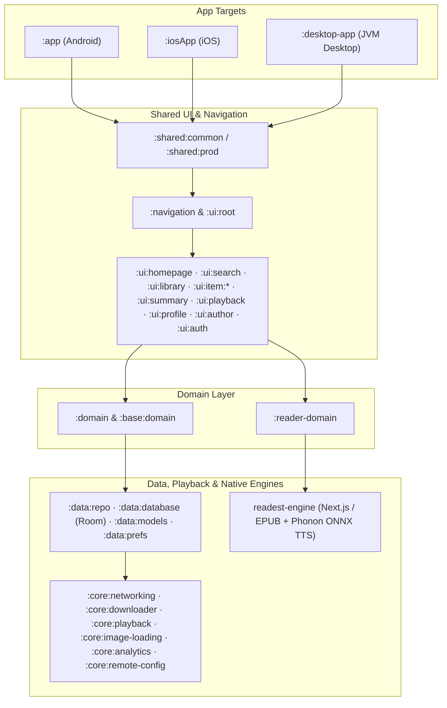

<div align="center">


<br />
<br />

# Bookble.

**Your Pocket Library of Timeless Classics — 36,900+ Free Books, Offline Neural AI Read Aloud, Radio Drama & Curated Summaries.**

<p>
  
  
  
  
  <a href="LICENSE"></a>
</p>

<p>
  <a href="#-features">Features</a> •
  <a href="#-screenshots">Screenshots</a> •
  <a href="#%EF%B8%8F-architecture">Architecture</a> •
  <a href="#%EF%B8%8F-tech-stack">Tech Stack</a> •
  <a href="#-getting-started">Getting Started</a> •
  <a href="#-localization--aso">Localization</a> •
  <a href="#-license">License</a>
</p>

</div>

---

## ✨ Overview

**Bookble** (`net.bookble.app`) is an ad-free, multiplatform digital library, customizable EPUB reader, audiobook & radio drama player, and offline neural AI voice companion built with **Kotlin & Compose Multiplatform**.

Designed for calm, distraction-free reading anywhere — with or without Wi-Fi — Bookble pairs thousands of curated public-domain classics, Bookble Originals, and poetry collections with structured book summaries, offline text-to-speech (`Phonon` + `Supertonic`), reading habit analytics, and 1-tap shareable Quote Cards.

---

## 🚀 Features

| Capability | Highlights |
| :--- | :--- |
| 📚 **36,900+ Classic Library** | Curated home feed, **Top 10 Charts**, genre shelves (*Thriller*, *Historical*, *Philosophy*, *Classics*), and rich author pages. |
| 📖 **Customizable EPUB Reader** | Powered by `readest-engine` & `reader-domain` — custom fonts, spacing, margins, dark/sepia/light themes, bookmarks, highlights, notes, and TOC. |
| 🎙️ **Offline AI Read Aloud (TTS)** | Built-in offline neural TTS (`Phonon` English + `Supertonic` across 31 languages) plus cloud voices with adjustable speed and background playback. |
| 🎧 **Audiobooks & Radio Drama** | Circular media player backed by Media3 (`core:playback`), chapter navigation, variable speed, background play, and built-in sleep timer. |
| 📝 **Immersive Book Summaries** | Spoiler-free teasers, key takeaways, reading-time estimates, and seamless jump-to-full-edition navigation. |
| 💬 **1-Tap Quote Maker** | Turn any passage into styled shareable cards (*Olive*, *Sand*, *Paper*, *Current*) with instant export to WhatsApp, Instagram, X, Telegram & Gmail. |
| 📊 **Offline Bookshelf & Tracker** | Download books for flights or commutes, filter shelves (*All / Reading / Not started / Completed*), and track daily streaks, minutes, and WPM. |

---

## 📱 Screenshots

<div align="center">

| Discovery | Charts, Authors & Genres | Book Details & Summaries | Reader & AI Read Aloud |
| :---: | :---: | :---: | :---: |
|  |  |  |  |

| Radio Drama & Audio | Offline Library | Shareable Quote Cards | Reading Tracker |
| :---: | :---: | :---: | :---: |
|  |  |  |  |

</div>

---

## 🏛️ Architecture

Bookble follows a modular **Clean / Multi-module Architecture** separating Compose Multiplatform UI screens, navigation, domain interactors, Room/SQLite persistence, Supabase & Firebase services, and the native EPUB/TTS engines:



### Module Directory

<details>
<summary><b>Click to expand full Gradle module map (from <code>settings.gradle</code>)</b></summary>

| Layer | Modules |
| :--- | :--- |
| **Targets & Shared** | `:app`, `:desktop-app`, `:desktop-kms`, `:baselineprofile`, `:shared:common`, `:shared:prod` |
| **Navigation & Theme** | `:navigation`, `:ui:root`, `:ui:theme`, `:ui:common`, `:ui:components`, `:ui:webview` |
| **Feature UI** | `:ui:homepage`, `:ui:search`, `:ui:library`, `:ui:item:detail`, `:ui:item:reviews`, `:ui:summary`, `:ui:playback`, `:ui:author`, `:ui:profile`, `:ui:auth` |
| **Domain & Reader** | `:domain`, `:reader-domain`, `:readest-engine`, `:base:domain`, `:base:annotations` |
| **Data** | `:data:repo`, `:data:database`, `:data:models`, `:data:platform`, `:data:prefs` |
| **Core Infrastructure** | `:core:networking`, `:core:downloader`, `:core:playback`, `:core:image-loading`, `:core:play`, `:core:purchase`, `:core:analytics`, `:core:remote-config` |

</details>

---

## 🛠️ Tech Stack

| Category | Technology / Library |
| :--- | :--- |
| **Language & UI** | Kotlin `2.2.0`, Compose Multiplatform `1.9.0-beta01`, Material 3 Adaptive `1.1.2`, Haze `1.6.9`, Lottie `6.6.7` |
| **Navigation & DI** | JetBrains Navigation Compose `2.8.0-alpha13`, Kotlin-Inject `0.7.2`, Coroutines `1.10.2` |
| **Persistence** | AndroidX Room `2.7.2`, SQLite Bundled `2.5.2`, Multiplatform Settings `1.3.0` |
| **Networking & Media** | Ktor `3.2.2`, OkHttp `5.1.0`, Coil 3 `3.3.0`, AndroidX Media3 `1.6.1`, FileKit `0.8.8` |
| **Backend & Cloud** | Supabase KT `3.2.6`, Firebase BOM `33.13.0` (Analytics, Crashlytics, Remote Config, Messaging), Credential Manager |
| **Reader & AI Audio** | Embedded `readest-engine` (`_next` static chunks bundled in APK assets), `libonnxruntime` (`phonon` offline neural TTS) |
| **Quality & Performance** | Spotless `7.2.1`, Baseline Profiles `1.3.4`, Maestro UI flows (`maestro/`) |

---

## ⚙️ Getting Started

### Prerequisites
- **JDK 17** (`JavaVersion.VERSION_17`)
- **Android Studio** (supporting AGP `8.11.1`, `compileSdk 36`, `minSdk 24`, NDK `28.2.13676358`)
- Valid `local.properties` and Firebase `google-services.json` (plus `keystore.jks` & `RELEASE_SIGNING_PASSWORD` env var for release builds)

### Common Build Commands

```bash
# Build Android Debug APK
./gradlew :app:assembleDebug

# Build slim arm64-v8a-only APK for physical 64-bit phones (ships single ONNX Runtime ABI)
./gradlew :app:assembleDebug -PbookbleArm64Only=true

# Run code formatting verification
./gradlew spotlessCheck

# Apply Spotless formatting
./gradlew spotlessApply
```

---

## 🌍 Localization & ASO

Bookble supports **13 in-app UI languages** across **24 Google Play Console locales** (`en-US/GB/CA/AU/IN/SG/ZA`, `ar`, `es-ES/419/US`, `pt-BR/PT`, `fr-FR/CA`, `de-DE`, `it-IT`, `ru-RU`, `ja-JP`, `pl-PL`, `nl-NL`, `fi-FI`, `zh-TW/HK`, `zh-CN`):

- 📄 **Store Listings (24 Locales):** [`docs/aso/google-play-multilang-listings.md`](docs/aso/google-play-multilang-listings.md)
- 👤 **Developer Page Promotional Copy:** [`docs/aso/google-play-developer-page-texts.md`](docs/aso/google-play-developer-page-texts.md)
- 🎨 **Play Store Creative Pack:** [`docs/aso/screenshots/en-US-v2/`](docs/aso/screenshots/en-US-v2/) (Screenshots, Feature Graphic, Developer Cover `4096×2304`, Promo Reel)

---

## 📄 License

Bookble is licensed under the **GNU General Public License v3.0 (GPL-3.0)** — see the [LICENSE](LICENSE) file for full details.

<div align="center">
  <br />
  
</div>
