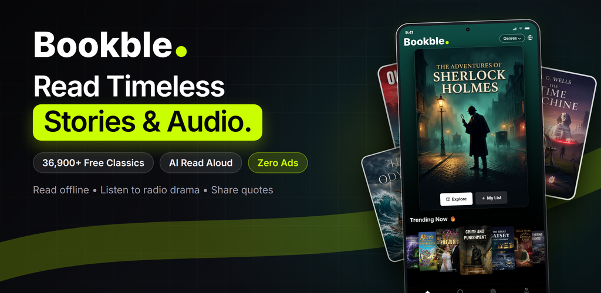
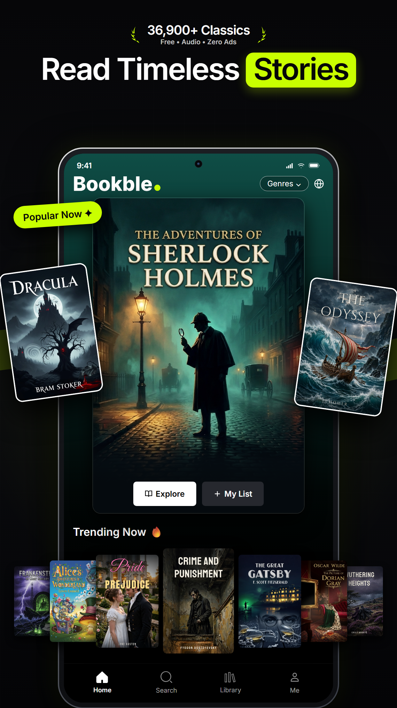
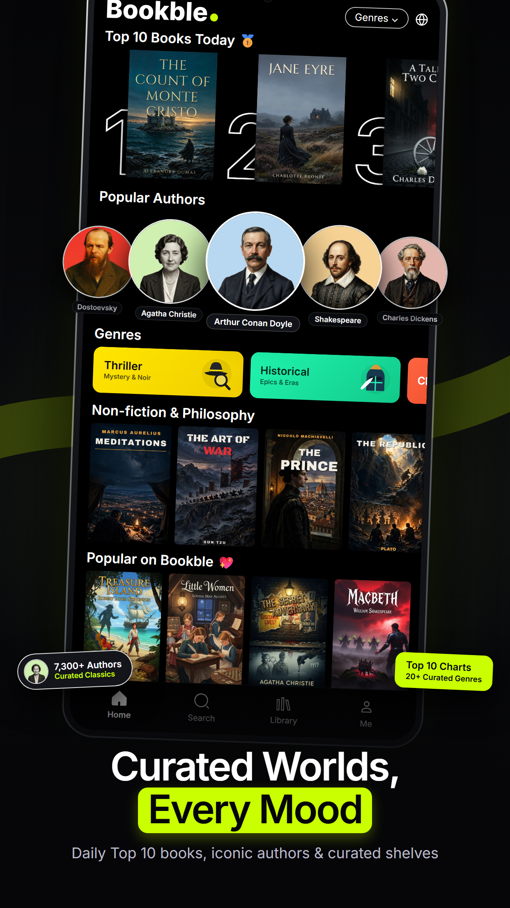
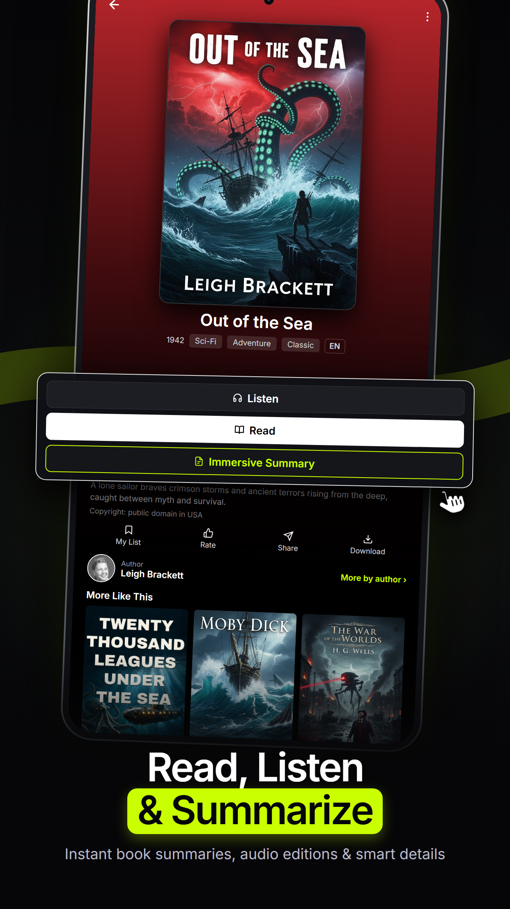
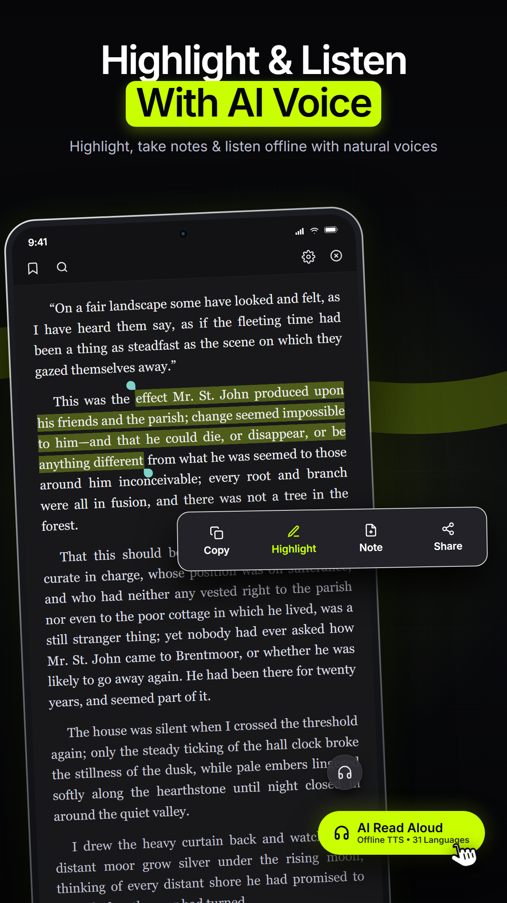
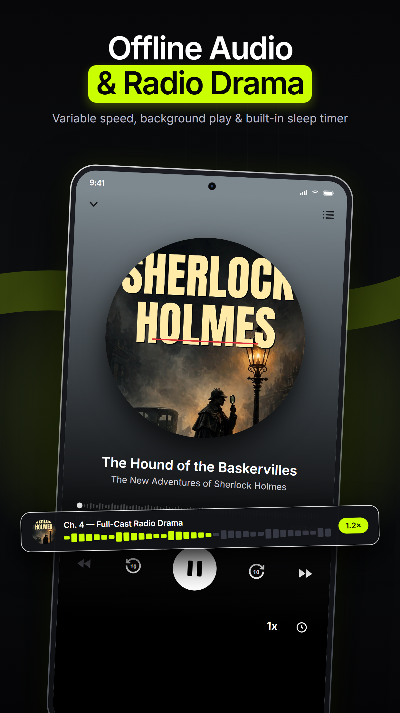
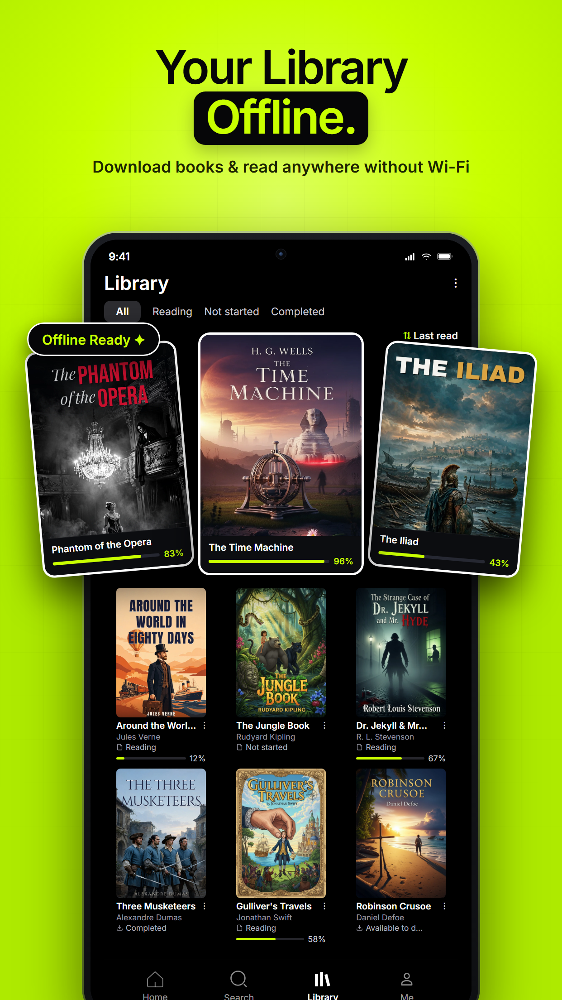
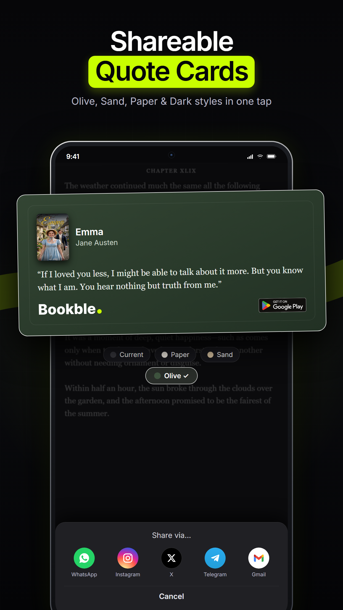
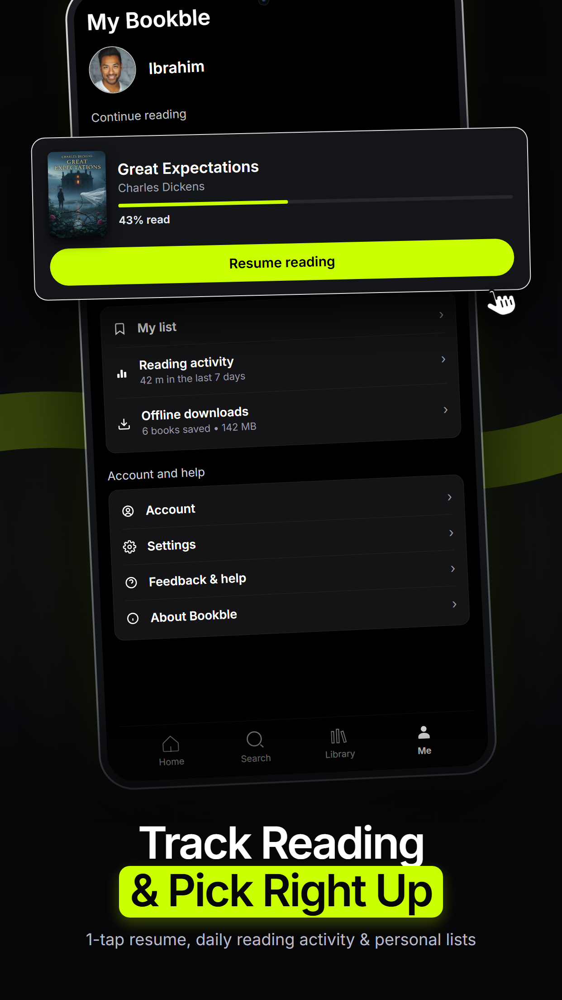
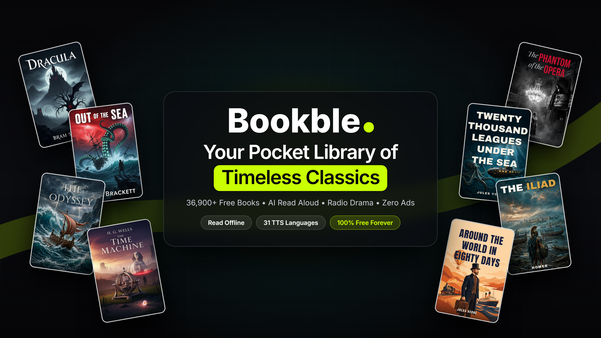

 
 

# Bookble.

### Escape the Endless Scroll. Read, Listen & Discover 36,900+ Timeless Books — 100% Free & Ad-Free.

  
  
  
  
  

  <a href="#-why-readers-choose-bookble">Why Bookble</a> •
  <a href="#-inside-the-app">Inside the App</a> •
  <a href="#-everything-you-need-in-one-calm-app">Features</a> •
  <a href="#-available-in-13-languages">13 Languages</a> •
  <a href="#-download-bookble-free">Download</a>

---

## ✨ Why Readers Choose Bookble

Most reading apps bombard you with subscriptions, locked chapters, or distracting ads. **Bookble** is built differently: a calm, studio-crafted pocket library where **36,900+ iconic books, audiobooks, radio dramas, and curated summaries** are yours to enjoy — **completely free, zero ads, and ready offline.**

- **🚫 Zero Ads. Zero Subscriptions.** Open any book and start reading from page one without interruptions or paywalls.
- **✈️ True Offline Freedom.** Save eBooks, audiobooks, and offline AI voices directly to your device for flights, subways, and quiet retreats without Wi-Fi.
- **🎧 Switch Seamlessly Between Reading & Listening.** Read comfortably at night, then tap **AI Read Aloud** or press play on a **Full-Cast Radio Drama** when your hands are busy.
- **⚡ Get the Core Insights Fast.** Short on time? Explore structured **Book Summaries** with key takeaways and dive straight into the full story whenever you wish.

---

## 📱 Inside the App

| 🏠 Effortless Discovery | 🏆 Top Charts & Iconic Authors | 🔍 Rich Book Details & Summaries | 🎙️ Highlight & AI Read Aloud |
| :---: | :---: | :---: | :---: |
|  |  |  |  |

| 🎭 Offline Audio & Radio Drama | 📥 Your Library Offline | 💬 Shareable Quote Cards | 📈 Reading Streaks & Progress |
| :---: | :---: | :---: | :---: |
|  |  |  |  |

---

## 🌟 Everything You Need in One Calm App

| Feature | What It Does For You |
| :--- | :--- |
| **📚 36,900+ Timeless Classics & Originals** | Explore curated shelves across *Mystery & Thriller*, *Historical Epics*, *Philosophy*, *Romance*, *Sci-Fi*, *Poetry*, and daily **Top 10 Charts**. |
| **🎙️ Offline AI Read Aloud (31+ Languages)** | Turn books into natural spoken audio even offline — adjust playback speed, jump chapters, and keep listening with your screen locked. |
| **🎭 Dedicated Audiobook & Radio Drama Player** | Enjoy full-cast radio drama and classic human-narrated audiobooks with chapter controls and a built-in **sleep timer** for bedtime listening. |
| **📖 Comfort-First eBook Reader** | Personalize fonts, line spacing, margins, and soothing **Dark, Sepia, Paper, or Light** reading modes with bookmarks, highlights & notes. |
| **💡 Spoiler-Free Book Summaries** | Preview a quick teaser, read structured takeaways with estimated read time, or jump straight into the unabridged classic edition. |
| **🎨 1-Tap Quote Card Studio** | Save favorite lines and turn them into share-worthy *Olive*, *Sand*, *Paper*, or *Dark* artwork ready for WhatsApp, Instagram, X, Telegram & Gmail. |
| **📊 Personal Bookshelf & Reading Tracker** | Organize *Reading*, *Not started*, and *Completed* books, track your daily streak and reading speed, and resume right where you left off. |

---

## 🌍 Available in 13 Languages

Bookble welcomes readers around the world with localized experiences in:

`English` · `العربية` · `Español` · `Português` · `Français` · `Deutsch` · `Italiano` · `Русский` · `日本語` · `Polski` · `Nederlands` · `Suomi` · `繁體中文 / 简体中文`

---

## 📲 Download Bookble Free

Ready to turn quiet moments into unforgettable stories?

   
  
   
  100% Free • Zero Ads • Offline Reading & Audio
    
  

---

  Licensed under <a href="LICENSE">GNU GPL v3.0</a> • Made for lifelong readers.

